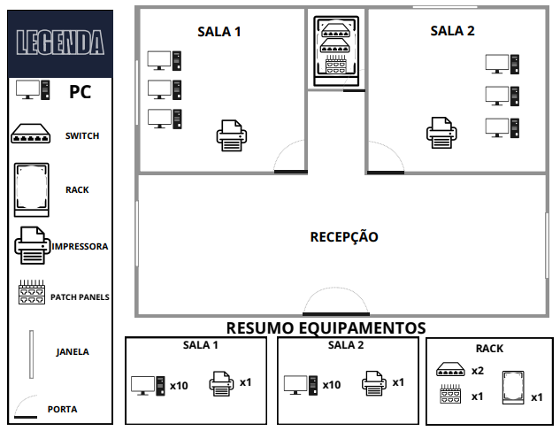
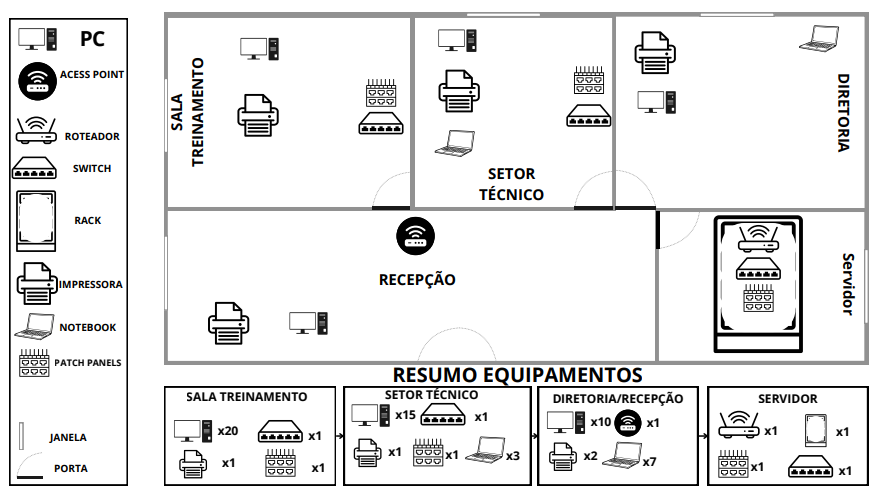
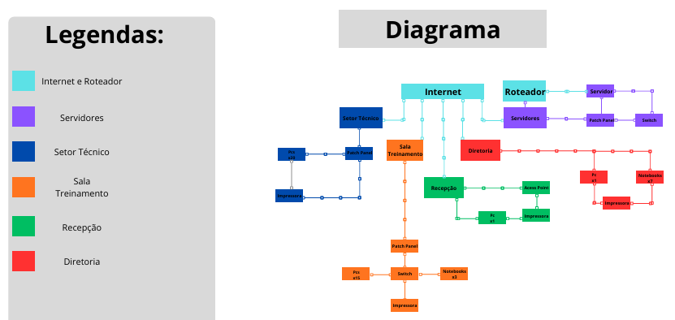

# expansao-infraestrutura-de-rede 

Projeto de Expansão de Infraestrutura de Redes 

📃 Descrição 

Este projeto foi desenvolvido em grupo durante uma atividade prática do curso técnico em Informática. O trabalho consiste na expansão de uma infraestrutura de redes utilizando o Cisco Packet Tracer. 

A atividade teve como objetivo ampliar a estrutura de rede de uma empresa, adicionar novos equipamentos, implementar uma rede Wireless (Wi-Fi) e elaborar a documentação da infraestrutura. 

Para representar o projeto, também foram desenvolvidos uma planta baixa e um diagrama da rede, mostrando a distribuição dos ambientes e a ligação entre os equipamentos. 

🎯 Objetivo 

Planejar e simular a expansão de uma infraestrutura de redes, aplicando conhecimentos sobre endereçamento IP, equipamentos de rede, comunicação entre dispositivos e rede Wireless. 

O projeto também permitiu praticar a elaboração de diagramas e a documentação de uma rede de computadores. 

🖥️ Sobre o projeto 

Na primeira parte da atividade, foram montadas duas redes no Cisco Packet Tracer. Na segunda parte, a proposta foi ampliar essa infraestrutura para atender às novas necessidades da empresa. 

Rede 1 

A Rede 1 representa uma rede local composta por: 

2 switches; 

10 computadores; 

1 impressora de rede. 

Rede 2 

A Rede 2 representa a infraestrutura principal da empresa e contempla os seguintes ambientes: 

Administrativo: computadores, impressoras e notebook; 

Recepção: computadores, impressora e acesso à rede Wireless; 

Setor técnico: computadores, impressora e notebook; 

Sala de treinamento: computadores e impressora; 

Servidor: equipamentos de infraestrutura; 

Rede Wireless: acesso sem fio para notebooks, smartphones e outros dispositivos compatíveis. 

A planta baixa mostra a divisão física dos ambientes. Na configuração realizada no Cisco Packet Tracer, o setor técnico e a sala de treinamento compartilham a mesma sub-rede IP. 

Conforme permitido pela atividade, a simulação utiliza uma quantidade reduzida de equipamentos para representar a estrutura planejada para a empresa. 

🌐 Estrutura da rede 

A infraestrutura foi organizada em duas redes principais: Rede 1 e Rede 2. 

Rede 1 

A Rede 1 foi organizada como uma rede local, utilizando dois switches para conectar os computadores e a impressora. 

Rede 2 

De acordo com o planejamento da atividade, a Rede 2 foi dividida em três redes: 

Rede 

Endereço de rede 

Administrativa 

192.168.10.0/24 

Técnica e treinamento 

192.168.20.0/24 

Wireless 

192.168.30.0/24 

O setor técnico e a sala de treinamento estão em ambientes físicos diferentes, mas compartilham a mesma sub-rede na configuração realizada. 

A rede Wireless foi integrada à infraestrutura por meio de um Access Point, permitindo a conexão de dispositivos sem fio. 

O roteador foi utilizado para interligar as redes configuradas na Rede 2. 

Observação: a tabela apresenta a divisão lógica prevista para a Rede 2. A configuração de endereços IP da Rede 1 e da rede administrativa da Rede 2 utiliza a mesma faixa 192.168.10.x, conforme realizado durante a atividade. Essa condição deve ser considerada na interpretação da topologia e dos testes. 

🛠️ Ferramentas utilizadas 

Cisco Packet Tracer: montagem e simulação da infraestrutura de rede; 

Canva: criação da planta baixa e do diagrama; 

Microsoft Excel: organização das informações do projeto. 

🧪 Testes de comunicação 

Após a configuração da rede no Cisco Packet Tracer, foram realizados testes para verificar a comunicação entre os dispositivos. 

Foi utilizado o comando ipconfig para consultar as configurações de rede dos computadores e o comando ping para testar a conectividade. 

Resultados dos testes 

Comunicação entre computadores da Rede 1: funcionando; 

Comunicação entre computadores da rede administrativa: funcionando; 

Comunicação entre dispositivos do setor técnico e da sala de treinamento: funcionando; 

Comunicação entre a rede administrativa e a rede técnica: funcionando; 

Comunicação entre a rede cabeada e a rede Wireless: funcionando; 

Comunicação entre dispositivos Wireless: funcionando. 

Os resultados correspondem aos testes registrados durante a atividade prática. Os testes permitiram verificar a conectividade entre os dispositivos utilizados na simulação. 

🗺️ Planta baixa 

A planta baixa representa a distribuição dos ambientes e dos equipamentos previstos para a infraestrutura da empresa. 

A imagem apresenta a organização dos dispositivos e a estrutura planejada para a Rede 1.

A imagem apresenta a distribuição dos setores e dos equipamentos da Rede 2.

🔌 Diagrama da rede 

O diagrama apresenta a organização da infraestrutura e a ligação entre os principais equipamentos, complementando as informações da planta baixa. 

💻 Simulação no Cisco Packet Tracer 

## 💻 Simulação no Cisco Packet Tracer

A simulação foi desenvolvida no Cisco Packet Tracer para representar a infraestrutura de rede e realizar testes de comunicação entre os dispositivos.

[📥 Baixar arquivo do Cisco Packet Tracer](./arquivo_cisco/PROJETO%20CISCO.pkt)

N🎥 Demonstração em vídeo 

O vídeo apresenta alguns testes de conectividade realizados no Cisco Packet Tracer, utilizando o comando ping para verificar a comunicação entre dispositivos da rede. 

Copie e cole o link no seu navegador para assistir ao video: https://www.youtube.com/watch?v=G-wyoJSOmQs&feature=youtu.be 

 

👥 Colaboradores 

Projeto desenvolvido em grupo durante uma atividade prática do curso técnico em Informática. 

Integrantes: 

Dhavi Rafael - github.com/Dhaviii001 

Everton Ferreira - github.com/bruzzinga-oss 

Matheus Henrique - github.com/mateus9ff-create 

 

✅ Conclusão 

A realização do projeto permitiu colocar em prática conhecimentos sobre infraestrutura de redes, endereçamento IP, equipamentos de rede, rede Wireless e testes de comunicação. 

A criação da planta baixa e do diagrama ajudou a representar a organização física dos ambientes e as conexões entre os equipamentos. 

A atividade também permitiu praticar a configuração de dispositivos no Cisco Packet Tracer e verificar a comunicação entre os equipamentos por meio dos comandos ipconfig e ping. 

O projeto contribuiu para ampliar os conhecimentos adquiridos durante o curso técnico em Informática e para compreender melhor o planejamento e a documentação de uma infraestrutura de redes. 

 
